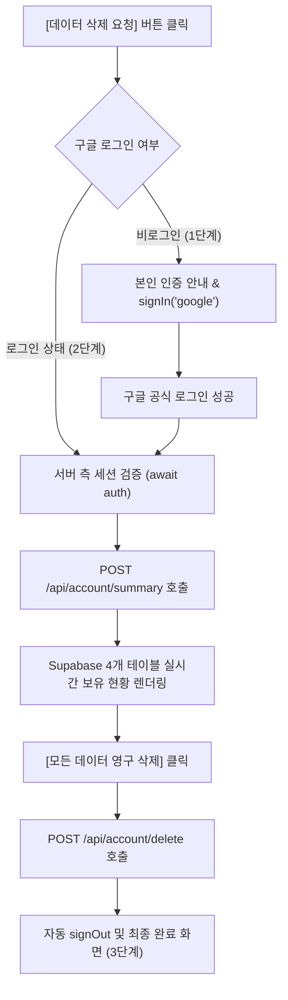

# 🚀 Vibe Coding Showcase & Google OAuth Compliance Landing

> **아무거나 Studio**에서 제작한 바이브코딩 PWA 웹 애플리케이션 제품군을 소개하고, Google OAuth 배포 검수를 충족하기 위한 **통합 개인정보처리방침(`/privacy`)**, **서비스 이용약관(`/terms`)** 및 **구글 계정 본인 인증 기반 데이터 사전 조회 / 삭제 / 익명화 파이프라인**을 제공하는 공식 랜딩 페이지입니다.

---

## 📌 1. 프로젝트 개요 (Overview)

- **프로젝트명**: 아무거나 Studio Landing Page (Vibe Coding Showcase)
- **개발자 / 운영자**: doohee2 ([GitHub](https://github.com/doohee2))
- **브랜드 슬로건**: Indie Vibe Lab · 유쾌하고 간결한 인디 소프트웨어를 만들고 배포합니다.
- **핵심 목적**:
  1. 바이브코딩으로 제작된 6가지 실용 웹 애플리케이션 쇼케이스 제공.
  2. Google API 서비스 사용자 데이터 정책(Google API Services User Data Policy)을 엄격히 준수하는 **통합 개인정보처리방침** 및 **서비스 이용약관** 공시.
  3. 구글 OAuth 검수 통과를 위한 **본인 확인 기반 계정 및 이용 데이터 실시간 사전 조회 및 영구 삭제/익명화 기능** 지원.

---

## 🛠️ 2. 기술 스택 & 개발 환경 (Tech Stack)

| 구분 | 기술 / 라이브러리 | 버전 / 비고 |
| :--- | :--- | :--- |
| **Framework** | **Next.js (App Router)** | v16+ (Turbopack 탑재) |
| **Core** | **React** | v19.3.0 |
| **Language** | **TypeScript** | v5.x (Strict Type Checking) |
| **Styling** | **Tailwind CSS** | v4 (`@tailwindcss/typography` 내장) |
| **Icons** | **Lucide Icons** | 최신 SVG 벡터 아이콘 세트 |
| **Authentication** | **NextAuth.js v5 Beta** | `auth.js` (Google OAuth Provider, 최소 스코프 `openid email profile`) |
| **Database Client**| **@supabase/supabase-js** | 개인정보 실시간 사전 조회 및 삭제/익명화 연동 |
| **Animation** | **framer-motion** | v14+ (카드 호버, 아코디언, 모달 트랜지션) |
| **Markdown** | **react-markdown** & **remark-gfm** | GFM 마크다운 표(Table) 파싱 및 고대비 다크모드 가독성 최적화 |

---

## ✨ 3. 핵심 기능 명세 (Key Features)

### 3.1. 문구 및 메타데이터 중앙 집중 관리 (`config/site.ts`)
- 사이트 타이틀, 브랜드 소개, 히어로 슬로건, 신뢰 지표, 개인정보처리방침·이용약관 링크, FAQ 질문/답변, 푸터 정보 등을 `config/site.ts` 파일 한 곳에서 일괄 수정 가능.
- 6개 앱의 메타데이터(이름, 카테고리, 설명, URL, 아이콘 경로, 태그, 버전)를 객체 배열로 정의하여 손쉬운 확장 보장.

### 3.2. 6대 실용 PWA 웹 애플리케이션 쇼케이스
| 앱 이름 | 카테고리 | 핵심 기능 설명 | 서비스 링크 |
| :--- | :--- | :--- | :--- |
| **Simple Reader** | `PDF / Reading` | 어디서나 PDF 파일을 읽고, 책갈피 및 번역 메모를 관리하는 스마트 이북 리더기 | [바로가기](https://simple-reader-doohee2.vercel.app/) |
| **Word Smart** | `Language Study` | 영어, 일본어 한자, 한자 단어 공부 및 SRS 학습 기록, 시험지 PDF 출력을 지원하는 단어장 | [바로가기](https://word-smart-doohee2.vercel.app/) |
| **Simple Schedule** | `Productivity` | 구글 캘린더와 노션 습관 체크리스트를 연동하여 일정과 루틴을 관리하는 심플 스케줄러 | [바로가기](https://simple-schedule-doohee2.vercel.app/) |
| **My Drive Finder** | `Cloud Search` | 구글 드라이브 내 대용량 Excel, CSV 파일의 내용을 클라이언트 사이드에서 초고속 검색 | [바로가기](https://my-drive-finder-doohee2.vercel.app/) |
| **Lens Dictionary** | `OCR & Lexicon` | 카메라 스캔을 지원하는 오프라인 StarDict 영한/영영 사전 앱 | [바로가기](https://lens-dict-doohee2.vercel.app/) |
| **Subway Tracker** | `Transit Live` | 서울/수도권 지하철 실시간 도착 정보 및 도착 알람을 지원하는 위치 추적 앱 | [바로가기](https://subway-tracker-doohee2.vercel.app/) |

- 모든 카드는 `framer-motion` 호버 인터랙션과 함께 새 탭(`target="_blank" rel="noopener noreferrer"`)으로 안전하게 연결됩니다.

### 3.3. 개인정보처리방침(`/privacy`) 및 서비스 이용약관(`/terms`) 마크다운 동적 렌더링
- **마크다운 원문 기반 관리**:
  - `content/privacy-policy.md` → 서버 컴포넌트(`app/privacy/page.tsx`)에서 Node.js `fs.readFileSync`로 읽어와 렌더링.
  - `content/terms-of-service.md` → 서버 컴포넌트(`app/terms/page.tsx`)에서 동일하게 읽어와 렌더링 (무료 공개용 인디 PWA 앱 특성에 맞춘 간결한 6개 조항으로 구성).
  - 원본 마크다운 문서를 수정하면 코드 수정 없이 즉시 각 페이지에 반영됩니다.
- **GFM 표(Table) 완벽 파싱 & 다크 모드 가독성 최적화**:
  - `remark-gfm` 플러그인을 탑재하여 표(Table)를 모바일 반응형 가로 스크롤 카드(`overflow-x-auto rounded-xl`)로 렌더링.
  - 본문 굵은 글씨(`strong`): 선명한 순백색(`text-white font-bold`), 일반 본문/목록(`p`, `li`): 고명도 슬레이트(`text-slate-200`), 인라인 코드 토큰: 라벤더 인디고(`text-[#c3c0ff]`).
- **상단·하단 양방향 퀵 내비게이션 & 삭제 모달 자동 오픈**:
  - `/privacy`와 `/terms` 페이지 모두 상단과 하단 양쪽에 왼쪽에는 **`메인 화면으로 돌아가기` (`/`)**, 오른쪽에는 **`데이터 삭제 요청` (`/?action=delete#deletion-section`)** 바로가기 버튼을 대칭 배치.
  - `데이터 삭제 요청` 클릭 시 메인 페이지(`app/page.tsx`)가 `?action=delete` 쿼리 파라미터를 감지하여 삭제 안내 섹션으로 스크롤함과 동시에 **데이터 삭제 모달을 자동으로 즉시 오픈**.

### 3.4. 구글 로그인 기반 개인정보 사전 조회 & 데이터 삭제 파이프라인
구글 개발자 검수(Verification)를 완벽히 통과하기 위한 다단계 UX 파이프라인을 지원합니다:



1. **엄격한 서버 측 보안 (Zero-Trust)**:
   - 클라이언트에서 전달하는 파라미터는 일체 신뢰하지 않으며, **오직 서버 세션(`await auth()`)에서 검증된 `session.user.email`만을 고정 식별자로 사용**하여 타인 데이터 조회 및 훼손을 원천 차단.
2. **실시간 개인정보 사전 조회 (`POST /api/account/summary`)**:
   - **이북 리더기 (Simple Reader)**: `pdf_metadata` 테이블 (`user_id = userEmail`) → 메모 개수, 북마크 개수 및 총 건수 집계.
   - **단어장 앱 (Word Smart)**: `study_history` 테이블 (`user_email = userEmail`) → 학습/테스트 기록 건수 집계.
   - **스케줄 앱 (Simple Schedule)**: `user_notion_tokens` 테이블 (`user_email = userEmail`) → 노션 연동 토큰 저장 여부.
   - **단어장 목록**: `word_lists` 테이블 (`user_email = userEmail`) → 보유 단어장 개수 및 제목(Title) 목록 표시.
3. **데이터 삭제 및 익명화 파이프라인 (`POST /api/account/delete`)**:
   - `pdf_metadata`, `study_history`, `user_notion_tokens`: 물리적 영구 삭제 (`delete`)
   - `word_lists`: 공유 단어장 생태계 보존을 위해 작성자 식별자를 `'anonymous'`로 마스킹 익명화 (`update`)
   - **[안전 조치 - 현재 상태]**: 실제 운영 환경에서의 오작동 방지 및 안전한 테스트를 위해, **실제 DB 쿼리 실행부는 임시 주석(`/* ... */`) 처리되어 Mock 응답 모드로 동작**합니다. 나중에 언제든지 주석을 풀어 즉시 실제 DB 파기 시스템으로 활성화할 수 있습니다.
4. **삭제 완료 후 조치**:
   - 200 OK 수신 후 브라우저 구글 세션을 자동 로그아웃(`signOut()`) 처리하고 최종 안내 화면 제공.

### 3.5. 브랜드 로고 아이콘 & 상단 GNB 사용자 프로필 / 로그아웃 UI
- **"아무거나 Studio" 전용 브랜드 로고**:
  - 딥 노터널 인디고 배경에 4개의 모듈형 타일(앱 블록, '아무거나'의 초성 `ㅇ` 링, 바이브 코딩 `<>` 브래킷, 인디고·민트 4각 스파클 별)을 조합한 로고 제작.
  - 컴포넌트(`components/BrandLogoIcon.tsx`)로 상단 헤더(`Header.tsx`)와 하단 푸터(`Footer.tsx`) 타이틀 옆에 배치.
  - 정적 에셋으로 벡터 원본(`public/icons/logo.svg`) 및 **512×512px 고해상도 PNG(`public/icons/logo.png`)**를 함께 제공하며, 브라우저 파비콘 및 Apple 터치 아이콘(`app/layout.tsx`)과 Google OAuth 앱 로고 등록에 활용 가능.
- **사용자 프로필 & 원클릭 로그아웃 인터랙션**:
  - 로그인 완료 시 상단 헤더에 사용자의 **전체 구글 이메일(`font-mono text-xs`)**과 **`[로그아웃]`** 뱃지를 표시.
  - **프로필 이미지 로딩 보장**: Google OAuth 프로필 이미지(`lh3.googleusercontent.com`)가 외부 도메인 Referer 정책으로 인해 차단되는 현상을 방지하기 위해 `referrerPolicy="no-referrer"` 속성을 적용하고, `next.config.ts`의 `images.remotePatterns`에 Google 이미지 도메인을 등록.
  - 프로필 버튼 클릭 시 즉시 구글 세션을 안전하게 종료(`signOut({ redirect: false })`)하며, 마우스 호버 시 붉은색 로그아웃 아이콘(`LogOut`)과 뱃지가 활성화되어 직관적인 피드백 제공.

---

## 📁 4. 디렉터리 및 파일 구조 (Directory Structure)

```text
landing/
├── app/
│   ├── layout.tsx                # NextAuth SessionProvider, 폰트, 메타데이터 및 파비콘(logo.svg / logo.png) 설정
│   ├── page.tsx                  # 메인 랜딩 원페이지 (?action=delete 감지 자동 모달 오픈 지원)
│   ├── privacy/
│   │   └── page.tsx              # 개인정보처리방침 전용 뷰 (상·하단 메인 복귀 & 데이터 삭제 요청 바로가기 포함)
│   ├── terms/
│   │   └── page.tsx              # 서비스 이용약관 전용 뷰 (상·하단 메인 복귀 & 데이터 삭제 요청 바로가기 포함)
│   ├── globals.css               # Tailwind CSS v4 테마 토큰 및 @plugin typography 설정
│   └── api/
│       ├── auth/[...nextauth]/
│       │   └── route.ts          # NextAuth v5 API 라우트 핸들러 (GET, POST)
│       └── account/
│           ├── summary/
│           │   └── route.ts      # 확인된 구글 이메일 기반 Supabase 실시간 데이터 사전 조회 API (POST)
│           └── delete/
│               └── route.ts      # 계정 데이터 영구 삭제 및 익명화 API (현재 DB 쿼리 주석 보존)
├── components/
│   ├── Providers.tsx             # NextAuth SessionProvider 클라이언트 컴포넌트 래퍼
│   ├── BrandLogoIcon.tsx         # "아무거나 Studio" 브랜드 로고 SVG 아이콘 컴포넌트
│   ├── Header.tsx                # 상단 GNB (브랜드 로고, 약관/개인정보 링크, 이메일 전체 표시 & 로그아웃 버튼)
│   ├── Hero.tsx                  # 앰비언트 글로우, 메인 슬로건, 개인정보/이용약관/데이터삭제 CTA, 신뢰 지표 3종
│   ├── AppCard.tsx               # 개별 앱 카드 컴포넌트 (framer-motion 호버, 아이콘, 외장 링크)
│   ├── AppGrid.tsx               # 6개 앱 쇼케이스 반응형 그리드
│   ├── PrivacySummary.tsx        # 메인 페이지용 핵심 정책 요약 카드 및 개인정보처리방침/이용약관 전문 링크
│   ├── DeletionSection.tsx       # 데이터 파기 안내 및 구글 연동 삭제 절차 안내 섹션
│   ├── DeleteDataModal.tsx       # 구글 로그인 본인 확인, 개인정보 사전 조회 및 삭제/익명화 확인 모달
│   ├── FAQSection.tsx            # 인터랙티브 아코디언 FAQ 및 이메일 문의 카드
│   └── Footer.tsx                # 브랜드 로고, 저작권, 개발자 정보(GitHub doohee2), 개인정보/약관/삭제 바로가기
├── config/
│   └── site.ts                   # 모든 문구, 브랜드 메타데이터, 앱 6종 설정을 중앙 관리하는 단일 진실 원천
├── content/
│   ├── privacy-policy.md         # Google OAuth 검수 규격 통합 개인정보처리방침 마크다운 원문
│   └── terms-of-service.md       # 공개용 인디 웹 앱 제품군 공통 서비스 이용약관 마크다운 원문
├── lib/
│   └── supabase.ts               # 서버 사이드 Supabase 클라이언트 유틸리티
├── auth.ts                       # NextAuth v5 설정 (Google Provider, least-privilege scope)
├── public/
│   └── icons/
│       ├── logo.svg              # "아무거나 Studio" 공식 벡터 로고 아이콘
│       ├── logo.png              # "아무거나 Studio" 512x512 고해상도 PNG 로고 아이콘 (OAuth/PWA 등록용)
│       └── apps/                 # 각 앱의 512x512 고화질 PNG 아이콘 에셋
├── .env.example                  # 프로덕션 배포용 필수 환경 변수 5종 템플릿
├── package.json                  # 프로젝트 의존성 및 스크립트 정의
└── GEMINI.md                     # 본 개발 및 운영 문서
```

---

## 🔐 5. 환경 변수 설정 (Environment Variables)

프로젝트 루트의 `.env.local` 파일 및 Vercel 배포 환경에 등록하는 **필수 5개 환경 변수** 목록입니다:

```env
# 1. NextAuth v5 세션 암호화 키 (32자 이상 난수)
AUTH_SECRET="your-nextauth-secret-key"

# 2. Google Cloud Console OAuth 2.0 클라이언트 ID 및 시크릿
AUTH_GOOGLE_ID="your-google-client-id.apps.googleusercontent.com"
AUTH_GOOGLE_SECRET="your-google-client-secret"

# 3. Supabase 프로젝트 URL 및 익명 공개 API 키
SUPABASE_URL="https://your-project.supabase.co"
SUPABASE_ANON_KEY="your-supabase-anon-key"
```

> **Google Cloud Console 설정 가이드 (`redirect_uri_mismatch` 방지):**
> 1. [Google Cloud Console](https://console.cloud.google.com/) > **API 및 서비스** > **사용자 인증 정보** 이동
> 2. **승인된 자바스크립트 원본 (Origins)**:
>    - `http://localhost:3000`
>    - `http://127.0.0.1:3000`
>    - `https://<당신의-배포-도메인>.vercel.app`
> 3. **승인된 리디렉션 URI (Redirect URIs)**:
>    - `http://localhost:3000/api/auth/callback/google`
>    - `http://127.0.0.1:3000/api/auth/callback/google`
>    - `https://<당신의-배포-도메인>.vercel.app/api/auth/callback/google`

---

## 💻 6. 실행 및 빌드 명령어 (Commands)

```bash
# 의존성 패키지 설치
npm install

# 로컬 개발 서버 실행 (Turbopack)
npm run dev

# 프로덕션 빌드 (TypeScript 검사 및 정적 사전 렌더링)
npm run build

# 빌드된 프로덕션 서버 실행
npm run start

# ESLint 코드 품질 및 컨벤션 검사
npm run lint
```

---

## 🔮 7. 향후 유지보수 및 확장 가이드 (Extension Guide)

### 1) Supabase 실제 DB 데이터 삭제 쿼리 활성화 방법
현재 [app/api/account/delete/route.ts](file:///c:/Users/doohe/OneDrive/Desktop/바이브코딩/landing/app/api/account/delete/route.ts) 파일의 실제 삭제 쿼리는 안전을 위해 주석 처리되어 있습니다.  
실제 DB 레코드 삭제를 운영 환경에 반영하려면:
1. 파일 상단의 `// import { supabase } from "@/lib/supabase";` 주석을 해제합니다.
2. `/* ... */` 블록으로 감싸진 4개 테이블 삭제 및 익명화 쿼리의 주석을 해제하면 즉시 실시간 데이터 파기 시스템으로 전환됩니다.

```typescript
const [delPdfRes, delStudyRes, delNotionRes, anonWordRes] = await Promise.all([
  supabase.from("pdf_metadata").delete().eq("user_id", userEmail),
  supabase.from("study_history").delete().eq("user_email", userEmail),
  supabase.from("user_notion_tokens").delete().eq("user_email", userEmail),
  supabase.from("word_lists").update({ user_email: "anonymous" }).eq("user_email", userEmail),
]);
```

### 2) 신규 애플리케이션 추가
1. `public/icons/apps/{앱영문이름}.png` 경로에 아이콘 이미지를 추가합니다.
2. `config/site.ts`의 `siteConfig.apps.list` 배열에 객체를 1개 추가하면 메인 화면의 쇼케이스 그리드에 즉시 반영됩니다.
